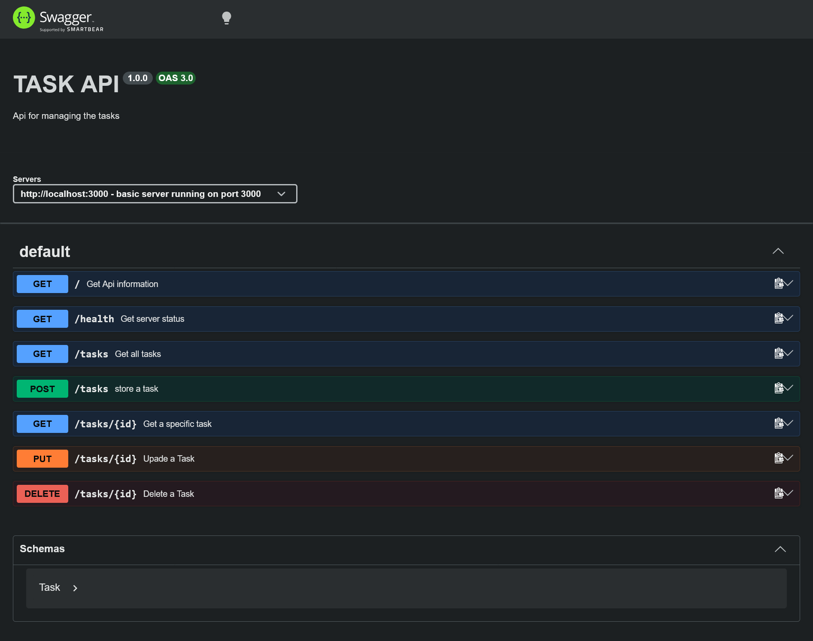

# Task Api

A simple CRUD API for managing tasks, built with Node.js and Express.js. It has no database so tasks are stored in memory and start with 3 hard coded tasks. Data resets whenever the server restarts. 

**Features**
- Create a new task
- Read all tasks or a single task
- Update a task
- Delete an existing task

## Install and run

Requirements: [Node.js](https://nodejs.org) 18 or newer

```bash
git clone https://github.com/aliasghar-codes/First-Crud-API---Internship.git
cd First-Crud-API---Internship
npm install
npm run dev
```

The server will run on http://localhost:3000 by default.  
Interactive Swagger UI: http://localhost:3000/api-docs


## Endpoints in the project

| Method | Path       | Description                     |
| ------ | --------   | ------------------------------- |
| GET    | /          | Get API info                    |
| GET    | /health    | Get server status               |
| GET    | /tasks     | Get all tasks                   |
| GET    | /tasks/:id | Get a specific task based on ID |
| POST   | /tasks     | Create a task                   |
| PUT    | /tasks/:id | Update a task                   |
| DELETE | /tasks/:id | Delete a task                   |

## Example request

```bash
curl -i http://localhost:3000/tasks
```
```
HTTP/1.1 200 OK
X-Powered-By: Express
Content-Type: application/json; charset=utf-8
Content-Length: 143
ETag: W/"8f-CZRnsbJnJBxT0KWsaUjwYxJ/ypQ"
Date: Sat, 17 Oct 2026 20:01:38 GMT
Connection: keep-alive
Keep-Alive: timeout=5

[{"id":1,"title":"create a file","done":false},{"id":2,"title":"create a folder","done":true},{"id":3,"title":"clean the laptop","done":false}]
```

## Swagger UI


